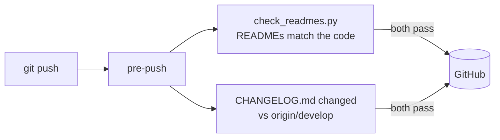

# `.githooks/`

Git hooks kept in the repo. Enable once per clone with `scripts/install_hooks.sh` (or
`scripts/install_hooks.ps1` on Windows), which sets `core.hooksPath`.

| Hook | Checks |
| --- | --- |
| `pre-push` | every folder README matches its code; the branch adds a CHANGELOG.md line |
