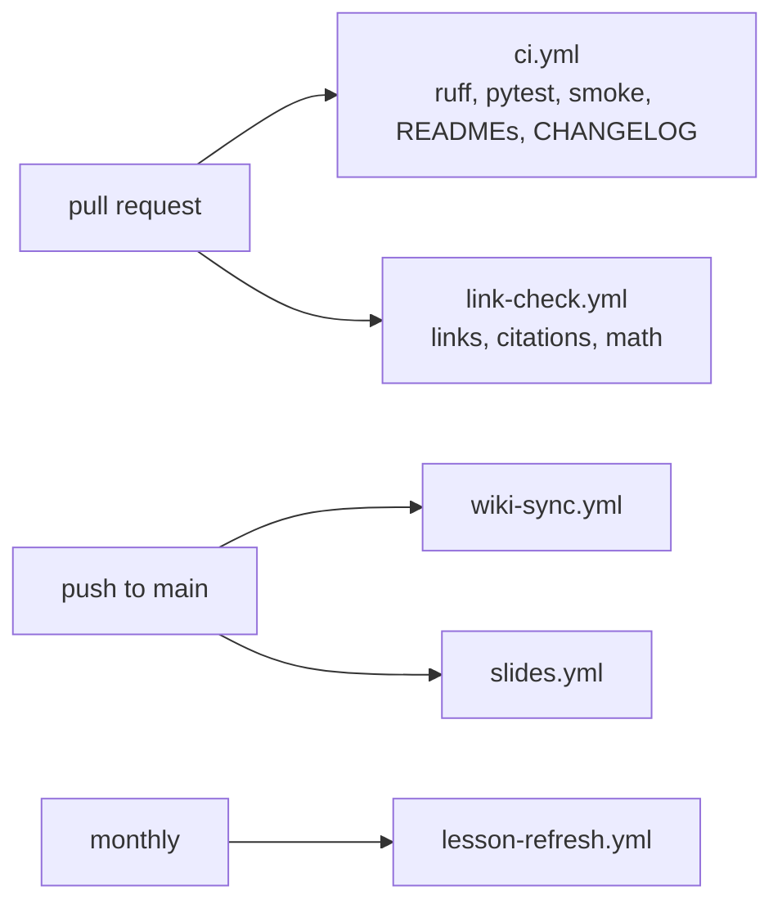

# `.github/workflows/`

| Workflow | Runs |
| --- | --- |
| `ci.yml` | tests, smoke run, README and CHANGELOG checks on pull requests and pushes to `main`/`develop` |
| `link-check.yml` | links, citations and math rendering when Markdown changes; weekly |
| `wiki-sync.yml` | rebuilds the wiki on push to `main` |
| `slides.yml` | publishes the Marp slides to Pages on push to `main` |
| `lesson-refresh.yml` | monthly lesson refresh PR |
