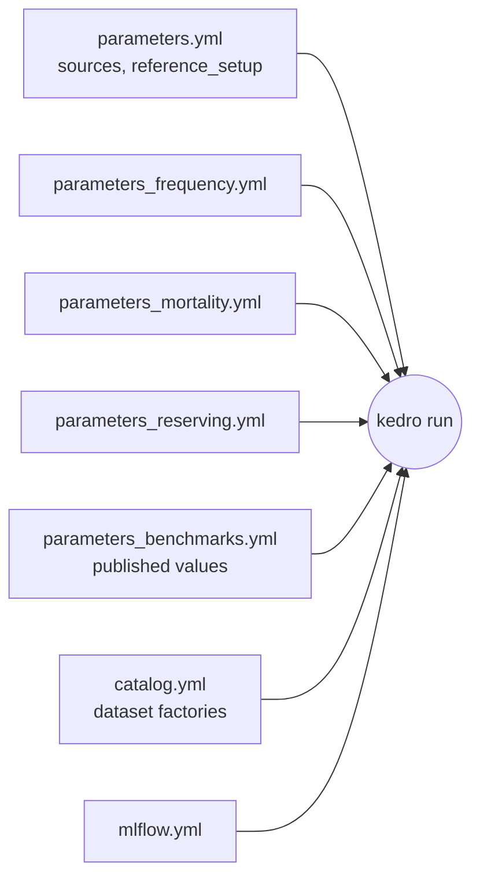

# `conf/base/`: the reference setup

Every setting the pipelines read. Benchmarks apply only here (`reference_setup: true`); other
environments override single keys (parameters are soft-merged).

| File | Holds |
| --- | --- |
| `parameters.yml` | data sources and `reference_setup` |
| `parameters_frequency.yml`, `parameters_mortality.yml`, `parameters_reserving.yml` | data scale and each model's settings, with the paper they follow |
| `parameters_benchmarks.yml` | published values, tolerances and their source table |
| `catalog.yml` | dataset factories for every namespace |
| `mlflow.yml` | kedro-mlflow tracking (SQLite `mlflow.db`) |
