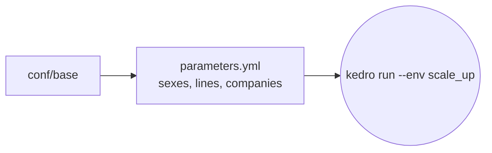

# `conf/scale_up/`

`kedro run --env scale_up`: beyond the reference setup. Both sexes for mortality, every line
and company for reserving; benchmarks report SKIPPED.

| File | Overrides |
| --- | --- |
| `parameters.yml` | `reference_setup: false`, mortality sexes, reserving lines and companies |
