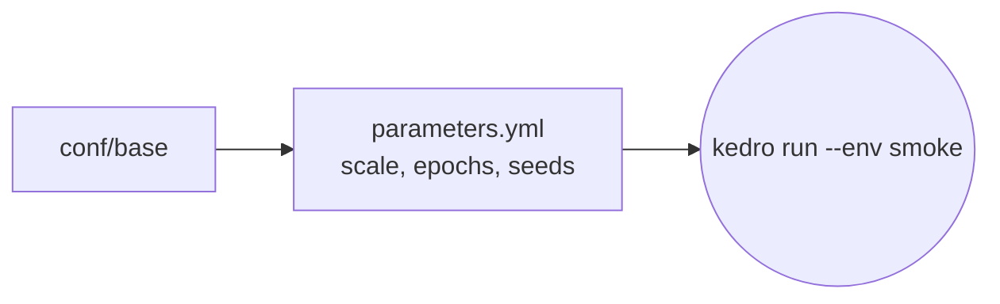

# `conf/smoke/`

`kedro run --env smoke`: 2% of the data and a few epochs, about a minute; used by CI.

| File | Overrides |
| --- | --- |
| `parameters.yml` | data scale, epochs and seeds per model; `reference_setup: false` |
