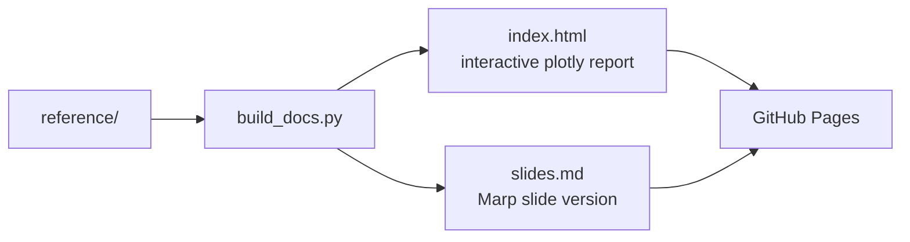

# `docs/`: visual summaries

Generated by `scripts/build_docs.py` from `reference/` (run by `scripts/freeze_reference.py`;
never edit by hand). Published to GitHub Pages with the slides: `report.html` and
`summary.html`.

| File | Is |
| --- | --- |
| `index.html` | the report: scorecard, distance of each reproduction from its paper, which model gaps are real, mortality seeds vs the published run, reserving; details expand; model version, data used, reproduce commands and links to the running systems |
| `slides.md` | the same story as a Marp deck |
