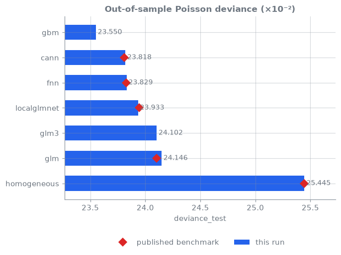
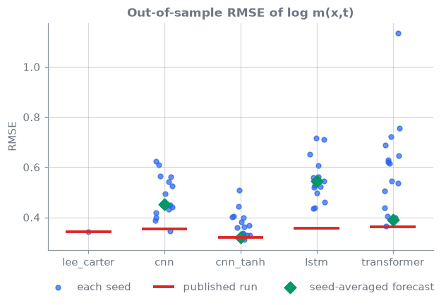
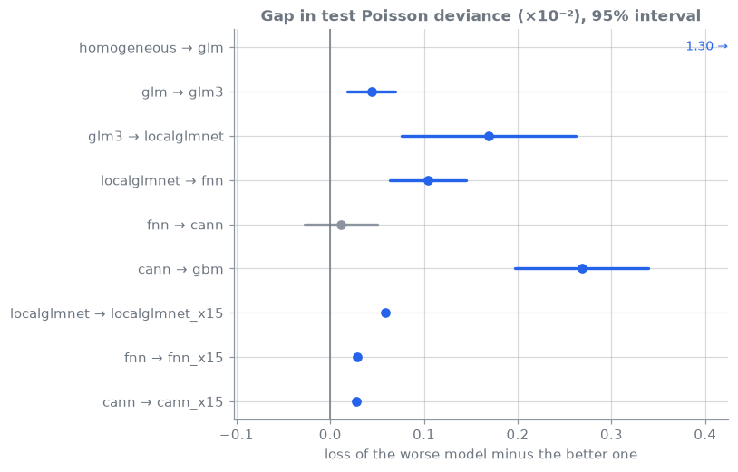

# Deep actuarial science: benchmark summary

Model version **0.1.0**, commit `9cd7aab`, frozen 2026-11-12.
Full interactive report: `docs/index.html`.

---

## Scorecard: 23 PASS, 2 FAIL

- **cann** deviance_learn: ours 23.79, paper 23.74
- **lstm** rmse_out: ours 0.5531, paper 0.3559

---

## Is the book's single mortality run typical?

| Network | Published | Our 15 seeds | Published run is |
| --- | --- | --- | --- |
| cnn | 0.3531 | 0.344–0.623 | inside the seed range |
| cnn_tanh | 0.3189 | 0.312–0.507 | inside the seed range |
| lstm | 0.3559 | 0.434–0.716 | better than every seed |
| transformer | 0.3624 | 0.366–1.134 | better than every seed |

---

## Which gaps are real?

---

## Data, reproduce, systems

- Data: freMTPL2; Swiss HMD; CAS Schedule P (Meyers' 50 companies)
- Reproduce: `git checkout 9cd7aab`, then `scripts/full_run.sh reference`
- [Repository](https://github.com/actuarialsociety/deep-actuarial-science) · [Wiki](https://github.com/actuarialsociety/deep-actuarial-science/wiki) · [CI](https://github.com/actuarialsociety/deep-actuarial-science/actions) · MLflow: `mlflow ui`
