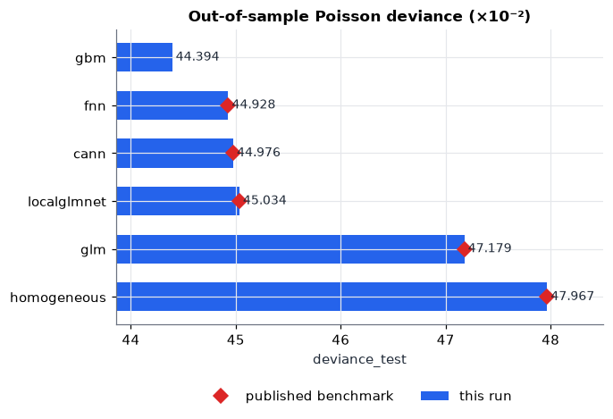

<!-- _class: lead -->
# 00 · Quickstart
### Theory → pipeline → reconciled result, in one command

[](https://colab.research.google.com/github/actuarialsociety/deep-actuarial-science/blob/main/notebooks/00_quickstart.ipynb) · `kedro run --env smoke`

---

## The workflow every lesson follows

1. **Theory:** one or two equations
2. **Model:** a class in `src/deep_actuarial_science/models/`, registered in a pipeline
3. **Config:** `conf/base/parameters_<domain>.yml` (model settings, data scale)
4. **Run:** `kedro run --pipeline <domain> --namespaces <model>`
5. **Reconcile:** results vs the published benchmark → `reconciliation.csv` (PASS / FAIL)
6. **Track:** parameters, metrics, figures, model and benchmark table in MLflow

---

## Run it three ways

```bash
# Colab: open a notebook from the README (clones, installs, runs the same pipeline)

# Container: JupyterLab + MLflow UI
docker compose up lab mlflow            # :8888 and :5000

# Local
kedro run --env smoke                                   # all pipelines, 2% data, ~2 min
kedro run --pipeline frequency --namespaces glm,cann    # chosen models, full data
kedro run --pipeline frequency --params frequency.data.scale=0.1
```

---

## Every model, one leaderboard



Out-of-sample Poisson deviance on 67,801 test policies. Diamonds: published benchmark.

---

## Reconciliation: the result is reproducible

| Model | Published test | This repo | Status |
| --- | --- | --- | --- |
| Homogeneous | 47.967 | <!--r:homogeneous.deviance_test-->47.967<!--/r--> | <!--r:homogeneous.status-->PASS<!--/r--> |
| GLM | 47.179 | <!--r:glm.deviance_test-->47.179<!--/r--> | <!--r:glm.status-->PASS<!--/r--> |
| FNN | 44.928 | <!--r:fnn.deviance_test-->44.928<!--/r--> | <!--r:fnn.status-->PASS<!--/r--> |
| CANN | 44.976 | <!--r:cann.deviance_test-->44.976<!--/r--> | <!--r:cann.status-->PASS<!--/r--> |
| LocalGLMnet | 45.034 | <!--r:localglmnet.deviance_test-->45.034<!--/r--> | <!--r:localglmnet.status-->PASS<!--/r--> |

Benchmarks: Wüthrich et al. (2025), *AI Tools for Actuaries*, notebook outputs [1].

---

## Change anything with config, never code

```yaml
# conf/base/parameters_frequency.yml
frequency:
  data:
    scale: 1.0            # 0.01-0.5 for quick experiments; 1.0 = benchmark setup
  models:
    cann:
      hidden: [20, 15, 10]
      epochs: 200
```

`kedro run --params frequency.models.cann.hidden=[32,16]` overrides one key for one run.

---

## Add a new model in four steps

1. Subclass `FrequencyModel` (or the mortality/reserving equivalent) and register it
2. Add `frequency.models.<name>` parameters
3. Add the namespace to the pipeline's `MODELS`, and a published benchmark if one exists
4. `kedro run --pipeline frequency --namespaces <name>`

Or in Claude Code: `/build-lesson <paper or model>`.

---

## Learn more

1. Wüthrich, M. V., Richman, R., Avanzi, B., Lindholm, M., Maggi, M., Mayer, M., Schelldorfer, J., & Scognamiglio, S. (2025). AI tools for actuaries. *SSRN 5162304*. [SSRN](https://papers.ssrn.com/sol3/papers.cfm?abstract_id=5162304)
2. Wüthrich, M. V., & Merz, M. (2023). *Statistical Foundations of Actuarial Learning and its Applications*. Springer. [doi:10.1007/978-3-031-12409-9](https://doi.org/10.1007/978-3-031-12409-9) (open access)
3. [Kedro documentation](https://docs.kedro.org/) · [MLflow documentation](https://mlflow.org/docs/latest/) · [Marp](https://marp.app/)

_Last reviewed: 2026-11-06_
