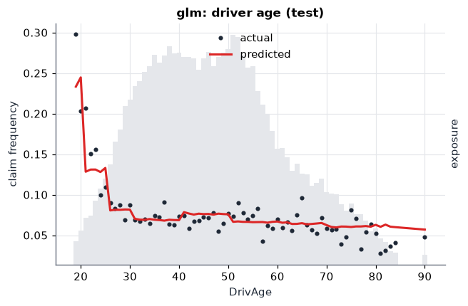
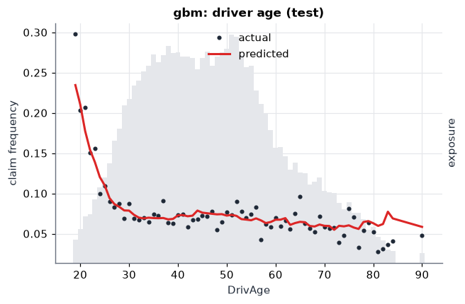
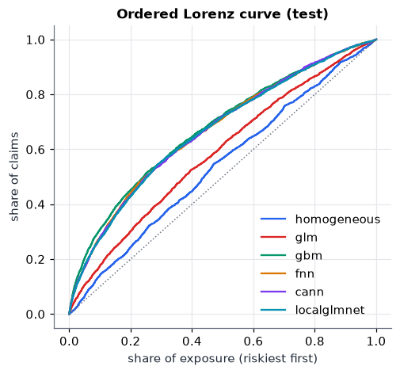
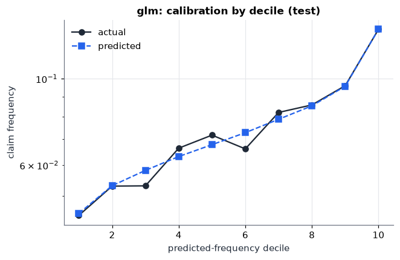

<!-- _class: lead -->
# 01 · Baselines: GLM and GBM
### What every deep model has to beat

[](https://colab.research.google.com/github/actuarialsociety/deep-actuarial-science/blob/main/notebooks/01_glm_gbm_baselines.ipynb) · `kedro run --pipeline frequency --namespaces homogeneous,glm,gbm`

---

## Theory

$$
N_i \sim \mathrm{Poi}\big(v_i\,\lambda(\boldsymbol{x}_i)\big), \qquad
\log \lambda^{\mathrm{GLM}}(\boldsymbol{x}) = \beta_0 + \langle \boldsymbol{\beta}, \boldsymbol{x}\rangle
$$

$$
D = \frac{2}{\sum_i v_i}\sum_i v_i \Big[\tfrac{\mu_i}{v_i} - \tfrac{N_i}{v_i} - \tfrac{N_i}{v_i}\log\tfrac{\mu_i}{N_i}\Big] \times 100
$$

- **GLM** [1]: interpretable, but features are hand-engineered (age bands, log density)
- **GBM** [2, 3]: learns interactions with trees; Poisson loss with $\log v_i$ as offset

---

## In code

```python
class GLM(FrequencyModel):
    def _fit(self, learn, params, base):
        d = add_glm_features(learn)           # bands, log(Density), capped BonusMalus
        self.result = smf_glm(params["formula"], data=d, offset=np.log(d.Exposure),
                              family=sm.families.Poisson()).fit()

class GBM(FrequencyModel):                    # LightGBM, objective="poisson"
    ...  init_score = np.log(exposure) + log(mean frequency)   # offset
```

`frequency.models.glm.formula: "ClaimNb ~ DrivAgeGLM + VehBrand + VehGas + DensityGLM + AreaGLM"`

---

## Results: reconciled to the benchmark

| Model | Learn | Test | Published test | Gini (test) | Status |
| --- | --- | --- | --- | --- | --- |
| Homogeneous | <!--r:homogeneous.deviance_learn-->47.722<!--/r--> | <!--r:homogeneous.deviance_test-->47.967<!--/r--> | 47.967 | <!--r:homogeneous.gini_test-->0.082<!--/r--> | <!--r:homogeneous.status-->PASS<!--/r--> |
| GLM | <!--r:glm.deviance_learn-->46.954<!--/r--> | <!--r:glm.deviance_test-->47.179<!--/r--> | 47.179 | <!--r:glm.gini_test-->0.172<!--/r--> | <!--r:glm.status-->PASS<!--/r--> |
| GBM | <!--r:gbm.deviance_learn-->44.144<!--/r--> | <!--r:gbm.deviance_test-->44.394<!--/r--> | n/a | <!--r:gbm.gini_test-->0.353<!--/r--> | leaderboard only |

Closed-form fits reproduce the published deviances to three decimals [4].

---

## Diagnostics

 

The GLM's age bands are step functions; the GBM finds the young-driver shape itself.

---

## Ranking and calibration

 

---

## In production

- **Calibration:** check actual vs expected by decile on the test set, not just deviance
- **Balance:** the GLM with intercept satisfies $\sum_i \hat\mu_i = \sum_i N_i$ on learn data
- **GBM:** tune with early stopping on a validation split; monitor feature drift
- **Baseline first:** a network that cannot beat a tuned GLM/GBM is not worth deploying

---

## Learn more

1. Nelder, J. A., & Wedderburn, R. W. M. (1972). Generalized linear models. *JRSS A*, 135(3), 370–384. [doi:10.2307/2344614](https://doi.org/10.2307/2344614)
2. Friedman, J. H. (2001). Greedy function approximation: a gradient boosting machine. *Annals of Statistics*, 29(5), 1189–1232. [doi:10.1214/aos/1013203451](https://doi.org/10.1214/aos/1013203451)
3. Ke, G., et al. (2017). LightGBM: a highly efficient gradient boosting decision tree. *NeurIPS 30*. [paper](https://proceedings.neurips.cc/paper/2017/hash/6449f44a102fde848669bdd9eb6b76fa-Abstract.html)
4. Wüthrich, M. V., & Merz, M. (2023). *Statistical Foundations of Actuarial Learning and its Applications*. Springer. [doi:10.1007/978-3-031-12409-9](https://doi.org/10.1007/978-3-031-12409-9)
5. Noll, A., Salzmann, R., & Wüthrich, M. V. (2018). Case study: French motor third-party liability claims. *SSRN 3164764*. [doi:10.2139/ssrn.3164764](https://doi.org/10.2139/ssrn.3164764)

_Last reviewed: 2026-11-06_
