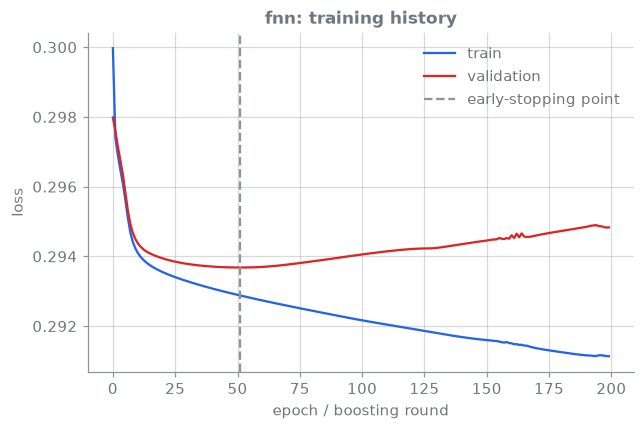
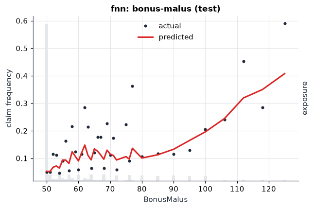

<!-- _class: lead -->
# 02 · Neural networks and embeddings
### Let the network learn the features the GLM needed by hand

[](https://colab.research.google.com/github/actuarialsociety/deep-actuarial-science/blob/main/notebooks/02_fnn_embeddings.ipynb) [](https://kaggle.com/kernels/welcome?src=https://github.com/actuarialsociety/deep-actuarial-science/blob/main/notebooks/02_fnn_embeddings.ipynb) [](https://studiolab.sagemaker.aws/import/github/actuarialsociety/deep-actuarial-science/blob/main/notebooks/02_fnn_embeddings.ipynb) · `kedro run --pipeline frequency --namespaces glm,fnn`

**Reproduces:** Brauer (2024) [[2](https://doi.org/10.1007/s13385-024-00388-2)], Table 2 (f), FNN with embeddings over 15 seeds

---

<!-- _class: theory -->

## Theory

**Model: feed-forward neural network (FNN) with entity embeddings** [[2](https://doi.org/10.1007/s13385-024-00388-2), [3](https://doi.org/10.1007/978-3-031-12409-9)]

```math
\lambda^{\mathrm{FNN}}(\boldsymbol{x}) = \exp\big\lbrace w_0 + \langle \boldsymbol{w}, \boldsymbol{z}^{(d:1)}(\boldsymbol{x})\rangle\big\rbrace,
\qquad \boldsymbol{z}^{(m)} = \tanh\big(W^{(m)}\boldsymbol{z}^{(m-1)} + \boldsymbol{b}^{(m)}\big)
```

where $\lambda^{\mathrm{FNN}}(\boldsymbol{x})$ = expected claims per year of cover; $\boldsymbol{z}^{(0)} = \boldsymbol{x}$ = scaled covariates plus embeddings; $\boldsymbol{z}^{(m)}$ = hidden layer $m = 1,\dots,d$ ($d = 3$: 20, 15, 10 units); $\boldsymbol{z}^{(d:1)} = \boldsymbol{z}^{(d)}\circ\cdots\circ\boldsymbol{z}^{(1)}$; $W^{(m)}, \boldsymbol{b}^{(m)}$ = weights and biases; $w_0, \boldsymbol{w}$ = output bias and weights

- **Entity embeddings** [[1](https://arxiv.org/abs/1604.06737)]: `VehBrand` and `Region` map to learned vectors in $\mathbb{R}^2$
- **Seeds matter:** the paper reports the mean ± sd over 15 fits, and so do we

---

## Core ideas

_Click a panel to open it; work through them in order._

<details>
<summary><b>① A GLM on learned features</b></summary>

The output layer is a Poisson GLM on $\boldsymbol{z}^{(d)}$: the network learns its own features, non-linearities and interactions instead of the GLM's bands. <!--r:fnn.n_params-->pending<!--/r--> parameters.

</details>

<details>
<summary><b>② Entity embeddings</b></summary>

**Entity embedding** of a categorical covariate with $K$ levels [[1](https://arxiv.org/abs/1604.06737)]: $e: \lbrace 1,\dots,K\rbrace \to \mathbb{R}^b$, $b = 2$

where $e(k)$ = the learned vector of level $k$. One-hot needs $K - 1$ inputs; an embedding needs $b$, and similar levels end up close together.

</details>

<details>
<summary><b>③ Training protocol of the paper</b></summary>

Brauer [[2](https://doi.org/10.1007/s13385-024-00388-2)]: Poisson deviance loss; nadam; batch 7,000; up to 500 epochs; early stopping with patience 15 on a 10% validation split; output weights 0 and bias $\log\bar\lambda$, so every fit starts at the homogeneous model ($\bar\lambda = \sum_i N_i / \sum_i v_i$). Inputs capped and standardised as in Wüthrich & Merz [[3](https://doi.org/10.1007/978-3-031-12409-9)], Sect. 7.3.2.

</details>

<details>
<summary><b>④ Fifteen seeds, each with its own split</b></summary>

Each fit draws its own seed and validation split [[2](https://doi.org/10.1007/s13385-024-00388-2)]. We report

$\displaystyle \bar D = \frac{1}{15}\sum_{s=1}^{15} D_s, \qquad \mathrm{sd} = \Big(\frac{1}{14}\sum_{s}(D_s - \bar D)^2\Big)^{1/2}$

where $D_s$ = deviance per policy of fit $s$. PASS if $\bar D$ is within twice the paper's sd. Averaging the 15 predictions (the *nagging predictor* [[5](https://doi.org/10.3390/risks8030083)]) scores better than any single fit.

</details>

<details>
<summary><b>⑤ The balance property breaks</b></summary>

**Balance correction** of the output bias [[4](https://doi.org/10.1007/s13385-019-00215-z)]

$\displaystyle w_0 \leftarrow w_0 + \log\frac{\sum_i N_i}{\sum_i \hat\mu_i}$

where $\hat\mu_i$ = predicted claim count on the learning data. Early stopping leaves $\sum_i \hat\mu_i \ne \sum_i N_i$ (here <!--r:fnn.balance_learn-->pending<!--/r-->×); the shift rescales every prediction equally (`balance_correction: true`).

</details>

---

## In code

```python
for run in range(params["n_runs"]):                    # 15 seeds (Brauer 2024)
    seed_everything(seed0 + run)
    train, val = split_train_val(learn, params, run)   # own 10% validation split
    net = EmbeddingFNN(n_cont, n_levels, [2, 2], [20, 15, 10], bias0=log_mean)
    train_poisson(net, train, val, epochs=500, batch_size=7000, patience=15)
```

---

## Results: reconciled to Brauer (2024) [[2](https://doi.org/10.1007/s13385-024-00388-2)], Table 2 (f)

Poisson deviance per policy, $\times 10^{-2}$; mean (sd) over 15 seeds.

| Model | Published learn | Published test | This repo learn | This repo test | Status |
| --- | --- | --- | --- | --- | --- |
| GLM1 ([[3](https://doi.org/10.1007/978-3-031-12409-9)], Table 5.3) | 24.101 | 24.146 | <!--r:glm.deviance_learn-->pending<!--/r--> | <!--r:glm.deviance_test-->pending<!--/r--> | <!--r:glm.status-->pending<!--/r--> |
| FNN | 23.768 (0.016) | 23.827 (0.015) | <!--r:fnn.deviance_learn-->pending<!--/r--> (<!--r:fnn.deviance_learn_sd-->pending<!--/r-->) | <!--r:fnn.deviance_test-->pending<!--/r--> (<!--r:fnn.deviance_test_sd-->pending<!--/r-->) | <!--r:fnn.status-->pending<!--/r--> |
| FNN, average of 15 | n/a | n/a | <!--r:fnn.deviance_ensemble_learn-->pending<!--/r--> | <!--r:fnn.deviance_ensemble_test-->pending<!--/r--> | |

---

## Diagnostics

 

---

## In production

- **Balance:** restore $\sum_i\hat\mu_i=\sum_i N_i$ before pricing [[4](https://doi.org/10.1007/s13385-019-00215-z)]
- **Seed risk:** single fits price individual policies differently; average several [[5](https://doi.org/10.3390/risks8030083)]
- **Explainability:** plot embeddings and marginal effects, or use LocalGLMnet (lesson 04)

---

## Learn more

1. Guo, C., & Berkhahn, F. (2016). Entity embeddings of categorical variables. [arXiv:1604.06737](https://arxiv.org/abs/1604.06737)
2. Brauer, A. (2024). Enhancing actuarial non-life pricing models via transformers. *European Actuarial Journal*, 14(3), 991–1012. [doi:10.1007/s13385-024-00388-2](https://doi.org/10.1007/s13385-024-00388-2)
3. Wüthrich, M. V., & Merz, M. (2023). *Statistical Foundations of Actuarial Learning and its Applications*. Springer. [doi:10.1007/978-3-031-12409-9](https://doi.org/10.1007/978-3-031-12409-9)
4. Wüthrich, M. V. (2020). Bias regularization in neural network models for general insurance pricing. *European Actuarial Journal*, 10(1), 179–202. [doi:10.1007/s13385-019-00215-z](https://doi.org/10.1007/s13385-019-00215-z)
5. Richman, R., & Wüthrich, M. V. (2020). Nagging predictors. *Risks*, 8(3), 83. [doi:10.3390/risks8030083](https://doi.org/10.3390/risks8030083)

_Last reviewed: 2026-11-07_
