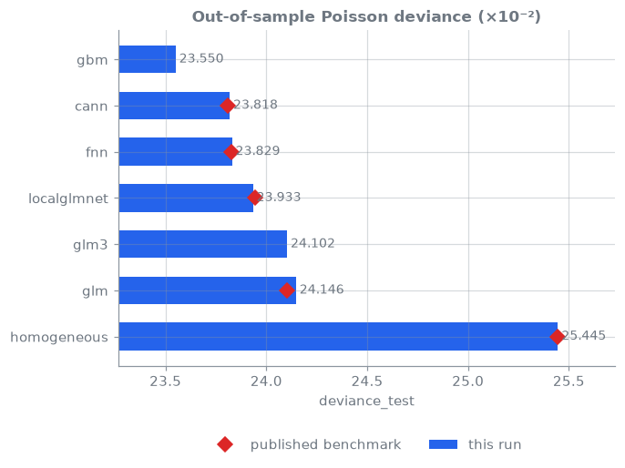
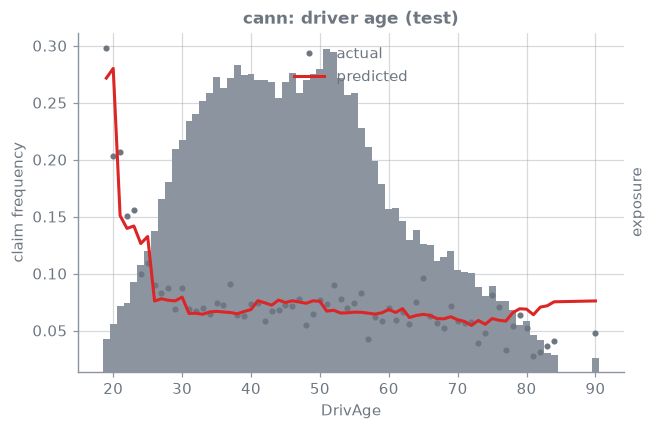
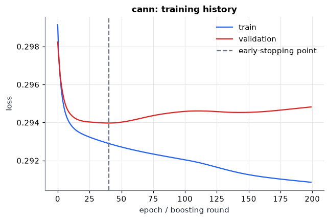

<!-- _class: lead -->
# 03 · CANN
### Nest the GLM inside a network: keep the baseline, learn what it misses

[](https://colab.research.google.com/github/actuarialsociety/deep-actuarial-science/blob/main/notebooks/03_cann.ipynb) [](https://kaggle.com/kernels/welcome?src=https://github.com/actuarialsociety/deep-actuarial-science/blob/main/notebooks/03_cann.ipynb) [](https://studiolab.sagemaker.aws/import/github/actuarialsociety/deep-actuarial-science/blob/main/notebooks/03_cann.ipynb) · `kedro run --pipeline frequency --namespaces glm3,cann`

**Reproduces:** Brauer (2024) [[3](https://doi.org/10.1007/s13385-024-00388-2)], Table 2 (g), CANN on GLM3 over 15 seeds

---

<!-- _class: theory -->

## Theory

**Model: Combined Actuarial Neural Network (CANN)** [[1](https://doi.org/10.1017/asb.2018.42), [2](https://doi.org/10.2139/ssrn.3320525)]

```math
\lambda^{\mathrm{CANN}}(\boldsymbol{x}) =
\underbrace{\lambda^{\mathrm{GLM3}}(\boldsymbol{x})}_{\text{offset}}\medspace
\exp\big\lbrace w_0 + \langle \boldsymbol{w}, \boldsymbol{z}^{(d:1)}(\boldsymbol{x})\rangle\big\rbrace
```

where $\lambda^{\mathrm{CANN}}(\boldsymbol{x})$ = expected claims per year of cover; $\lambda^{\mathrm{GLM3}}$ = the fitted GLM3 of lesson 01, kept fixed; $\boldsymbol{z}^{(d:1)}(\boldsymbol{x})$ = last hidden layer of the lesson 02 network; $w_0, \boldsymbol{w}$ = output bias and weights; $\exp\lbrace\cdot\rbrace$ = the learned multiplicative correction

- **Zero initialisation:** $w_0 = 0,\ \boldsymbol{w} = \boldsymbol{0}$ ⇒ training starts *exactly* at GLM3 [[1](https://doi.org/10.1017/asb.2018.42), [2](https://doi.org/10.2139/ssrn.3320525)]
- If training barely moves the correction, GLM3 was adequate

---

## Core ideas

_Click a panel to open it; work through them in order._

<details>
<summary><b>① Learn the residual on the log scale</b></summary>

**CANN on the log scale**: $\log\lambda^{\mathrm{CANN}}(\boldsymbol{x}) = \log\lambda^{\mathrm{GLM3}}(\boldsymbol{x}) + w_0 + \langle\boldsymbol{w}, \boldsymbol{z}^{(d)}(\boldsymbol{x})\rangle$

GLM3 is fitted first and frozen; its expected counts, exposure included, enter as the offset. Only the correction is trained.

</details>

<details>
<summary><b>② Start exactly at GLM3</b></summary>

With $w_0 = 0$, $\boldsymbol{w} = \boldsymbol{0}$ the correction is $\exp(0) = 1$, so before training $\lambda^{\mathrm{CANN}} = \lambda^{\mathrm{GLM3}}$; training moves away only if that lowers the loss. `test_cann_starts_exactly_at_glm` checks it on every CI run.

</details>

<details>
<summary><b>③ Same network and protocol as lesson 02</b></summary>

As in Brauer [[3](https://doi.org/10.1007/s13385-024-00388-2)]: the FNN with embeddings, layers (20, 15, 10), nadam, batch 7,000, patience 15, 15 seeds each with its own 10% validation split. Only the offset (GLM3 instead of exposure) and the initial bias (0) differ.

</details>

<details>
<summary><b>④ What the correction picks up, and how to read it</b></summary>

For each policy $c(\boldsymbol{x}) = \exp(w_0 + \langle\boldsymbol{w}, \boldsymbol{z}^{(d)}(\boldsymbol{x})\rangle)$ is the factor on top of the GLM3 price.

- Interactions and shapes GLM3 does not contain
- $c \approx 1$ everywhere: GLM3 was adequate; segments with $c$ far from 1 are candidates for new GLM terms

</details>

<details>
<summary><b>⑤ Balance after early stopping</b></summary>

GLM3 is balanced, the correction is not (here <!--r:cann.balance_learn-->pending<!--/r-->× observed claims on the learning data). Restore it with the bias shift of lesson 02, $w_0 \leftarrow w_0 + \log(\sum_i N_i / \sum_i \hat\mu_i)$, before pricing [[4](https://doi.org/10.1080/24754269.2021.1877960)].

</details>

---

## In code

```python
class CANN(FNN):           # lesson 02's network and training ...
    uses_base = True       # ... with the frozen GLM3's expected counts as offset

nn.init.zeros_(self.out.weight)       # output weights start at zero
nn.init.constant_(self.out.bias, 0)   # → CANN(x) = GLM3(x) before training
```

`frequency.models.cann` (15 seeds); the pipeline wires `glm3.freq_model` in as the base.

---

## Results: reconciled to Brauer (2024) [[3](https://doi.org/10.1007/s13385-024-00388-2)], Table 2 (g)

Poisson deviance per policy, $\times 10^{-2}$; mean (sd) over 15 seeds.

| Model | Published learn | Published test | This repo learn | This repo test | Status |
| --- | --- | --- | --- | --- | --- |
| GLM3 ([[5](https://doi.org/10.1007/978-3-031-12409-9)], Table 5.5) | 24.084 | 24.102 | <!--r:glm3.deviance_learn-->pending<!--/r--> | <!--r:glm3.deviance_test-->pending<!--/r--> | <!--r:glm3.status-->pending<!--/r--> |
| CANN | 23.742 (0.061) | 23.810 (0.033) | <!--r:cann.deviance_learn-->pending<!--/r--> (<!--r:cann.deviance_learn_sd-->pending<!--/r-->) | <!--r:cann.deviance_test-->pending<!--/r--> (<!--r:cann.deviance_test_sd-->pending<!--/r-->) | <!--r:cann.status-->pending<!--/r--> |
| FNN (lesson 02) | 23.768 (0.016) | 23.827 (0.015) | <!--r:fnn.deviance_learn-->pending<!--/r--> | <!--r:fnn.deviance_test-->pending<!--/r--> | <!--r:fnn.status-->pending<!--/r--> |



---

## Where the network corrects the GLM

 

---

## In production

- **Governance:** GLM3 stays filed and explainable; the CANN is a documented uplift
- **Calibration:** restore the balance property before pricing [[4](https://doi.org/10.1080/24754269.2021.1877960)]
- **Monitoring:** track the correction $c(\boldsymbol{x})$ by segment over time
- **Next step:** transformer models on the same data and split report lower test deviance [[3](https://doi.org/10.1007/s13385-024-00388-2), [6](https://doi.org/10.1007/s13385-025-00413-y)]

---

## Learn more

1. Wüthrich, M. V., & Merz, M. (2019). Editorial: Yes, we CANN! *ASTIN Bulletin*, 49(1), 1–3. [doi:10.1017/asb.2018.42](https://doi.org/10.1017/asb.2018.42)
2. Schelldorfer, J., & Wüthrich, M. V. (2019). Nesting classical actuarial models into neural networks. *SSRN 3320525*. [doi:10.2139/ssrn.3320525](https://doi.org/10.2139/ssrn.3320525)
3. Brauer, A. (2024). Enhancing actuarial non-life pricing models via transformers. *European Actuarial Journal*, 14(3), 991–1012. [doi:10.1007/s13385-024-00388-2](https://doi.org/10.1007/s13385-024-00388-2)
4. Wüthrich, M. V. (2022). The balance property in neural network modelling. *Statistical Theory and Related Fields*, 6(1), 1–9. [doi:10.1080/24754269.2021.1877960](https://doi.org/10.1080/24754269.2021.1877960)
5. Wüthrich, M. V., & Merz, M. (2023). *Statistical Foundations of Actuarial Learning and its Applications*. Springer. [doi:10.1007/978-3-031-12409-9](https://doi.org/10.1007/978-3-031-12409-9)
6. Richman, R., Scognamiglio, S., & Wüthrich, M. V. (2025). The credibility transformer. *European Actuarial Journal*, 15(2), 345–379. [doi:10.1007/s13385-025-00413-y](https://doi.org/10.1007/s13385-025-00413-y)

_Last reviewed: 2026-11-07_
