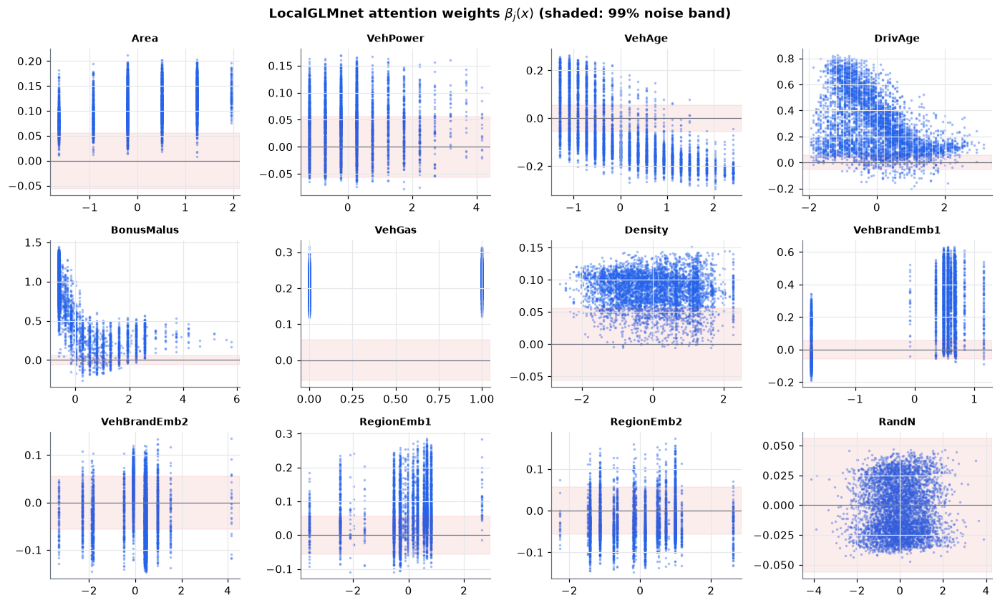
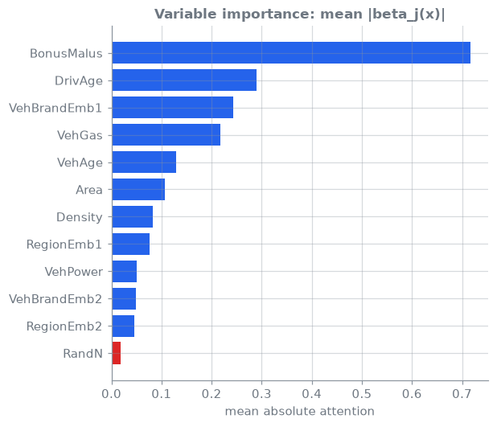

<!-- _class: lead -->
# 04 · LocalGLMnet
### A network that reads like a GLM, with built-in variable selection

[](https://colab.research.google.com/github/actuarialsociety/deep-actuarial-science/blob/main/notebooks/04_localglmnet.ipynb) [](https://kaggle.com/kernels/welcome?src=https://github.com/actuarialsociety/deep-actuarial-science/blob/main/notebooks/04_localglmnet.ipynb) [](https://console.aws.amazon.com/sagemaker/home#/studio-landing) · `kedro run --pipeline frequency --namespaces localglmnet`

**Reproduces:** Richman & Wüthrich (2023) [[1](https://doi.org/10.1080/03461238.2022.2081816)], Table 2 (c)

---

<!-- _class: theory -->

## Theory

**Model: LocalGLMnet** [[1](https://doi.org/10.1080/03461238.2022.2081816)]

```math
\log \lambda(\boldsymbol{x}) = \beta_0 + \sum_{j=1}^{q} \beta_j(\boldsymbol{x})\thinspace x_j,
\qquad \big(\beta_1(\boldsymbol{x}),\dots,\beta_q(\boldsymbol{x})\big) = \boldsymbol{z}^{(d:1)}(\boldsymbol{x})
```

where $\lambda(\boldsymbol{x})$ = expected claims per year of cover; $x_j$ = feature $j$; $q = 42$ features (one-hot categoricals and two noise controls); $\beta_0$ = intercept; $\beta_j(\boldsymbol{x})$ = the **regression attention**: feature $j$'s coefficient for this policy; $\boldsymbol{z}^{(d:1)}$ = a network with layers (20, 15, 10) and $q$ outputs

- $\beta_j(\boldsymbol{x})\equiv\beta_j$: a GLM term; $\beta_j\equiv0$: drop $x_j$; $\beta_j$ varies with $x_k$: interaction [[1](https://doi.org/10.1080/03461238.2022.2081816)]
- **Significance:** pure-noise features `RandU` and `RandN` show how much a useless coefficient varies

---

## Core ideas

_Click a panel to open it; work through them in order._

<details>
<summary><b>① A GLM whose coefficients depend on the policy</b></summary>

**Attention layer**: $\boldsymbol\beta(\boldsymbol{x}) = W\boldsymbol{z}^{(d)}(\boldsymbol{x}) + \boldsymbol{b} \in \mathbb{R}^q$

where $\boldsymbol{z}^{(d)}$ = last hidden layer (tanh); $W, \boldsymbol{b}$ = weights and bias of the linear attention layer. Each prediction decomposes into $\beta_j(\boldsymbol{x})\thinspace x_j$ terms.

</details>

<details>
<summary><b>② The paper's 42 features</b></summary>

Richman & Wüthrich [[1](https://doi.org/10.1080/03461238.2022.2081816)], Sect. 3: the six continuous features and binary `VehGas`, centred and scaled to unit variance (after the caps of [[3](https://doi.org/10.1007/978-3-031-12409-9)], Sect. 7.3.2); `VehBrand` and `Region` one-hot; plus `RandU` (uniform) and `RandN` (normal), centred with unit variance. Because inputs are standardised, attention sizes are comparable.

</details>

<details>
<summary><b>③ Start at a GLM on the same design</b></summary>

A Poisson GLM is fitted on the 42 features; attention weights $W = 0$, bias $\boldsymbol{b}$ = its coefficients, $\beta_0$ = its intercept. So $\boldsymbol\beta(\boldsymbol{x}) \equiv \boldsymbol{b}$ before training (`test_localglmnet_starts_exactly_at_its_glm`); the hidden layers start from Keras's Glorot-uniform weights. Training as in [[1](https://doi.org/10.1080/03461238.2022.2081816)]: nadam, batch 5,000, 100 epochs, the weights of the lowest validation loss; 15 seeds.

</details>

<details>
<summary><b>④ A noise band for significance</b></summary>

**Interval of the paper** [[1](https://doi.org/10.1080/03461238.2022.2081816)], eq. (16), at significance level 0.1%: $\pm 3.291\thinspace s$

where $s$ = standard deviation of $\beta_{\text{RandN}}(\boldsymbol{x})$ across policies. A feature whose $\beta_j(\boldsymbol{x})$ stays inside the band is indistinguishable from noise; the paper drops `Area` and `VehPower` this way.

</details>

<details>
<summary><b>⑤ Variable importance</b></summary>

**Variable importance** of feature $j$: $\mathrm{VI}_ j = \frac{1}{n}\sum_{i=1}^{n}|\beta_j(\boldsymbol{x}_ i)|$

where $n$ = number of policies. Compare with `RandU` and `RandN`; a feature near them adds little.

</details>

---

## In code

```python
class LocalGLMnetNet(nn.Module):
    def betas(self, x):                     # one coefficient per feature
        z = x
        for layer in self.hidden:
            z = torch.tanh(layer(z))
        return self.attention(z)            # weights 0, bias = start-GLM coefficients
    def forward(self, x, offset):
        return torch.exp(self.intercept + (self.betas(x) * x).sum(1)) * offset
```

---

## Results: reconciled to Richman & Wüthrich (2023) [[1](https://doi.org/10.1080/03461238.2022.2081816)], Table 2 (c)

Poisson deviance per policy, $\times 10^{-2}$. The paper reports one run; we report the mean (sd) over 15 seeds, with a tolerance of twice the seed sd Brauer [[2](https://doi.org/10.1007/s13385-024-00388-2)], Table 2 (h), reports for this model.

| Model | Published learn | Published test | This repo learn | This repo test | Status |
| --- | --- | --- | --- | --- | --- |
| LocalGLMnet | 23.728 | 23.945 | <!--r:localglmnet.deviance_learn-->23.721<!--/r--> (<!--r:localglmnet.deviance_learn_sd-->0.039<!--/r-->) | <!--r:localglmnet.deviance_test-->23.933<!--/r--> (<!--r:localglmnet.deviance_test_sd-->0.025<!--/r-->) | <!--r:localglmnet.status-->PASS<!--/r--> |
| CANN (lesson 03) | 23.742 | 23.810 | <!--r:cann.deviance_learn-->23.787<!--/r--> | <!--r:cann.deviance_test-->23.818<!--/r--> | <!--r:cann.status-->**FAIL**<!--/r--> |

Gap in test deviance, 95% interval over test policies (lesson 00, Core ideas ⑥):

- **GLM3 → LocalGLMnet:** <!--r:gap.glm3.localglmnet-->0.169 (0.076 to 0.261)<!--/r-->, <!--r:verdict.glm3.localglmnet-->real<!--/r-->
- **LocalGLMnet → FNN:** <!--r:gap.localglmnet.fnn-->0.104 (0.064 to 0.145)<!--/r-->, <!--r:verdict.localglmnet.fnn-->real<!--/r-->: the price of a network that reads like a GLM

---

## Attention weights: read them like coefficients



---

## Variable importance



---

## In production

- **Explainability:** $\beta_j(\boldsymbol{x})x_j$ gives each policy's premium decomposition
- **Variable selection:** test against noise features before filing rating factors
- **Same checks as any network:** balance property, seed stability, drift
- **Beyond pricing:** the same architecture forecasts mortality accurately and explainably [[4](https://doi.org/10.1080/03461238.2024.2307620)]

---

## Learn more

1. Richman, R., & Wüthrich, M. V. (2023). LocalGLMnet: interpretable deep learning for tabular data. *Scandinavian Actuarial Journal*, 2023(1), 71–95. [doi:10.1080/03461238.2022.2081816](https://doi.org/10.1080/03461238.2022.2081816)
2. Brauer, A. (2024). Enhancing actuarial non-life pricing models via transformers. *European Actuarial Journal*, 14(3), 991–1012. [doi:10.1007/s13385-024-00388-2](https://doi.org/10.1007/s13385-024-00388-2)
3. Wüthrich, M. V., & Merz, M. (2023). *Statistical Foundations of Actuarial Learning and its Applications*. Springer. [doi:10.1007/978-3-031-12409-9](https://doi.org/10.1007/978-3-031-12409-9)
4. Perla, F., Richman, R., Scognamiglio, S., & Wüthrich, M. V. (2024). Accurate and explainable mortality forecasting with the LocalGLMnet. *Scandinavian Actuarial Journal*, 2024(7), 739–761. [doi:10.1080/03461238.2024.2307620](https://doi.org/10.1080/03461238.2024.2307620)

_Last reviewed: 2026-11-10_
