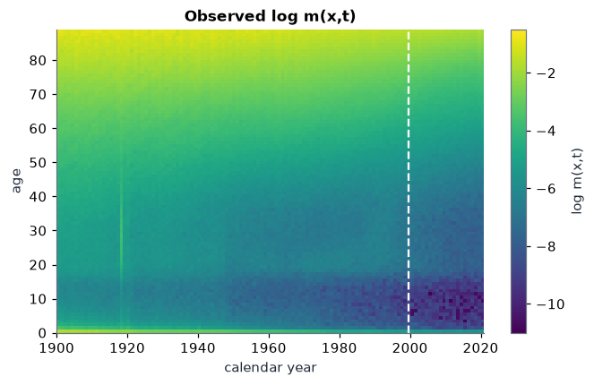
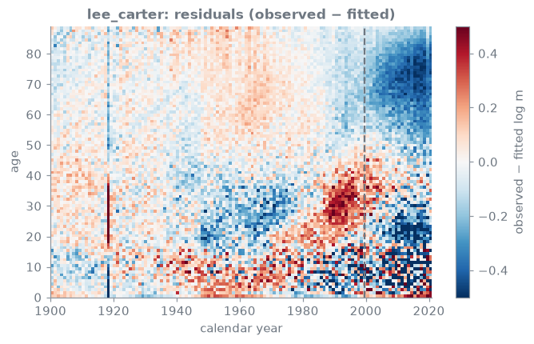
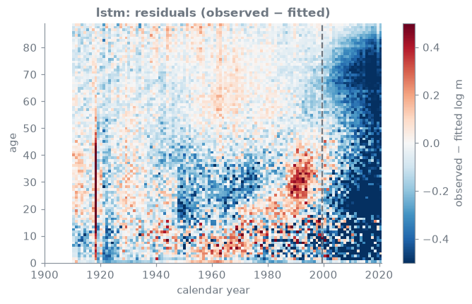
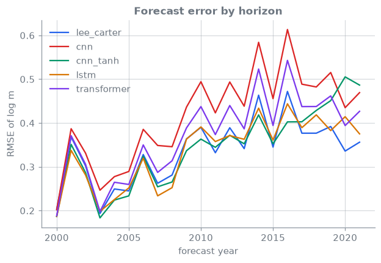
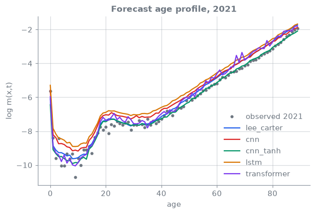

<!-- _class: lead -->
# 05 · Mortality: Lee–Carter to deep learning
### Forecast 22 years of Swiss mortality with Lee–Carter, CNNs, an LSTM and a Transformer

[](https://colab.research.google.com/github/actuarialsociety/deep-actuarial-science/blob/main/notebooks/05_mortality.ipynb) [](https://kaggle.com/kernels/welcome?src=https://github.com/actuarialsociety/deep-actuarial-science/blob/main/notebooks/05_mortality.ipynb) [](https://console.aws.amazon.com/sagemaker/home#/studio-landing) · `kedro run --pipeline mortality`

**Reproduces:** Richman, Scognamiglio & Wüthrich (2026) [[2](https://aitools4actuaries.com/Ch8E/mortality_forecasting.pdf)], *AI Tools for Actuaries*, Ch. 8, pp. 50 and 56

---

<!-- _class: theory -->

## Theory

**Model 1: Lee–Carter** [[1](https://doi.org/10.1080/01621459.1992.10475265)]

```math
\log m_{x,t} = a_x + b_x k_t, \qquad k_{t+1} = k_t + \delta + \varepsilon_{t+1}
```

where $m_{x,t}$ = central death rate at age $x$ in calendar year $t$ (deaths ÷ person-years lived); $a_x$ = average log death rate at age $x$; $k_t$ = period index, the general mortality level in year $t$; $b_x$ = how strongly age $x$ follows $k_t$; $\delta$ = drift, the average yearly change in $k_t$; $\varepsilon_{t+1}$ = random error

**Model 2: neural forecaster** [[2](https://aitools4actuaries.com/Ch8E/mortality_forecasting.pdf), [3](https://doi.org/10.1080/03461238.2020.1867232)]

```math
\log m_{\cdot,t} = f_\theta\big(\log m_{\cdot,t-10},\dots,\log m_{\cdot,t-1}\big)
```

where $\log m_{\cdot,t}$ = log death rates for all ages 0–89 in year $t$; $f_\theta$ = a network with weights $\theta$ (CNN, non-linear CNN, LSTM or Transformer); forecasts are **recursive**

---

## Core ideas

_Click a panel to open it; work through them in order._

<details>
<summary><b>① The data</b></summary>

Human Mortality Database, Swiss males, ages 0–89, years 1900–2021; zero rates floored at $e^{-11}$ before taking logs, as in [[2](https://aitools4actuaries.com/Ch8E/mortality_forecasting.pdf)]. Learn 1900–1999, forecast 2000–2021 (22 years).

</details>

<details>
<summary><b>② Lee–Carter fit and forecast</b></summary>

$a_x$ = row means of $\log m_{x,t}$; a singular value decomposition of the centred matrix gives the rank-1 fit $b_x k_t$, made unique by $\sum_x b_x = 1$, $\sum_t k_t = 0$.

**Random walk with drift forecast** [[1](https://doi.org/10.1080/01621459.1992.10475265), [2](https://aitools4actuaries.com/Ch8E/mortality_forecasting.pdf)]: $\hat k_{T+h} = k_T + h\thinspace\hat\delta$, $\hat\delta = (k_T - k_1)/(T-1)$

where $T$ = last learning year (1999); $h$ = years ahead; $\hat\delta$ = mean yearly change of $k_t$ (R `rwf(kt, drift = TRUE)` in [[2](https://aitools4actuaries.com/Ch8E/mortality_forecasting.pdf)]).

</details>

<details>
<summary><b>③ Next year from the last ten</b></summary>

As in [[2](https://aitools4actuaries.com/Ch8E/mortality_forecasting.pdf)]: each sample is a 10 × 90 window (years × ages) of min–max scaled $\log m$, the target the next year's 90 rates. Windows shuffled (seed 100); 10% validation; Adam, learning rate 0.001, batch 4, 1,000 epochs, rate × 0.9 after 5 stalled epochs; the best epoch is kept. Mean squared error loss.

</details>

<details>
<summary><b>④ Four ways to read a window</b></summary>

As in [[2](https://aitools4actuaries.com/Ch8E/mortality_forecasting.pdf)], with its parameter counts:

- **CNN** (3,063): 1-D convolution over time, 3 filters of width 3, the 90 ages as channels; dense to 90
- **Non-linear CNN** (7,843): tanh dense to 20 features per year, convolution, tanh dense of 50, linear output
- **LSTM** (6,990): dense to 20 features per year, a 20-unit LSTM with **linear** activation, dense to 90
- **Transformer** (3,118): 3 features per year, one attention block with a learned scale, skip connections, layer normalisation

</details>

<details>
<summary><b>⑤ Recursive forecasts and the score</b></summary>

From 2000 each prediction is fed back in: 22 steps, so errors compound with horizon.

**Root mean squared error (RMSE)** of log death rates: $\sqrt{\frac{1}{|S|}\sum_{(x,t)\in S}(\log m_{x,t} - \widehat{\log m}_ {x,t})^2}$

where $S$ = all (age, year) cells of 2000–2021 (out-of-sample) or 1910–1999 (in-sample, after the first window).

</details>

---

## The data: HMD Switzerland, males, 1900–2021



Learn 1900–1999, forecast 2000–2021 (dashed line).

---

## Results: reconciled to [[2](https://aitools4actuaries.com/Ch8E/mortality_forecasting.pdf)], Ch. 8

RMSE of $\log m_{x,t}$. Lee–Carter is closed-form and must match exactly; each network is a single published run ("not very robust" [[2](https://aitools4actuaries.com/Ch8E/mortality_forecasting.pdf)]), so the band is ±0.05.

| Model | Published in / out | This repo in-sample | This repo out-of-sample | Status |
| --- | --- | --- | --- | --- |
| Lee–Carter | 0.1555 / 0.3416 (p. 50) | <!--r:lee_carter.rmse_in-->pending<!--/r--> | <!--r:lee_carter.rmse_out-->pending<!--/r--> | <!--r:lee_carter.status-->pending<!--/r--> |
| CNN | 0.2108 / 0.3531 (p. 50) | <!--r:cnn.rmse_in-->pending<!--/r--> | <!--r:cnn.rmse_out-->pending<!--/r--> | <!--r:cnn.status-->pending<!--/r--> |
| Non-linear CNN | 0.1866 / 0.3189 (p. 56) | <!--r:cnn_tanh.rmse_in-->pending<!--/r--> | <!--r:cnn_tanh.rmse_out-->pending<!--/r--> | <!--r:cnn_tanh.status-->pending<!--/r--> |
| LSTM | 0.1746 / 0.3559 (p. 50) | <!--r:lstm.rmse_in-->pending<!--/r--> | <!--r:lstm.rmse_out-->pending<!--/r--> | <!--r:lstm.status-->pending<!--/r--> |
| Transformer | 0.2277 / 0.3624 (p. 50) | <!--r:transformer.rmse_in-->pending<!--/r--> | <!--r:transformer.rmse_out-->pending<!--/r--> | <!--r:transformer.status-->pending<!--/r--> |

No peer-reviewed table reports this exact setup; [[2](https://aitools4actuaries.com/Ch8E/mortality_forecasting.pdf)] is the authored source of these numbers.

---

## Where forecasts go wrong

 

Right of the dashed line: forecast errors by age and year. Note the 1918 influenza spike in the training data.

---

## Forecast quality by horizon

 

---

## In production

- **Look-ahead:** [[2](https://aitools4actuaries.com/Ch8E/mortality_forecasting.pdf)] scales $\log m$ with all years, test included; set `mortality.training.scaler_fit: learn` for an honest forecast
- **Recursive error growth:** report errors by horizon, not one number
- **Uncertainty:** point forecasts are not enough for reserving; bootstrap intervals [[5](https://doi.org/10.1017/asb.2021.34)]
- **Many populations:** networks extend Lee–Carter to many populations jointly [[6](https://doi.org/10.1017/S1748499519000071)]; transformers forecast HMD populations directly [[4](https://doi.org/10.1080/03461238.2023.2218859)]

---

## Learn more

1. Lee, R. D., & Carter, L. R. (1992). Modeling and forecasting U.S. mortality. *JASA*, 87(419), 659–671. [doi:10.1080/01621459.1992.10475265](https://doi.org/10.1080/01621459.1992.10475265)
2. Richman, R., Scognamiglio, S., & Wüthrich, M. V. (2026). *AI Tools for Actuaries*, Chapter 8: Example mortality rate forecasting with CNNs, RNNs and Transformers (version 2026-04-19). [PDF](https://aitools4actuaries.com/Ch8E/mortality_forecasting.pdf)
3. Perla, F., Richman, R., Scognamiglio, S., & Wüthrich, M. V. (2021). Time-series forecasting of mortality rates using deep learning. *Scandinavian Actuarial Journal*, 2021(7), 572–598. [doi:10.1080/03461238.2020.1867232](https://doi.org/10.1080/03461238.2020.1867232)
4. Wang, J., Wen, L., Xiao, L., & Wang, C. (2024). Time-series forecasting of mortality rates using transformer. *Scandinavian Actuarial Journal*, 2024(2), 109–123. [doi:10.1080/03461238.2023.2218859](https://doi.org/10.1080/03461238.2023.2218859)
5. Schnürch, S., & Korn, R. (2022). Point and interval forecasts of death rates using neural networks. *ASTIN Bulletin*, 52(1), 333–360. [doi:10.1017/asb.2021.34](https://doi.org/10.1017/asb.2021.34)
6. Richman, R., & Wüthrich, M. V. (2021). A neural network extension of the Lee–Carter model to multiple populations. *Annals of Actuarial Science*, 15(2), 346–366. [doi:10.1017/S1748499519000071](https://doi.org/10.1017/S1748499519000071)

Data: [Human Mortality Database](https://www.mortality.org/).

_Last reviewed: 2026-11-07_
