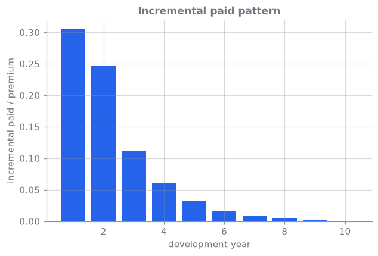

<!-- _class: lead -->
# 06 · Reserving: chain-ladder to neural ODP
### A CANN for triangles, back-tested on what was actually paid

[](https://colab.research.google.com/github/actuarialsociety/deep-actuarial-science/blob/main/notebooks/06_reserving.ipynb) · `kedro run --pipeline reserving`

---

## Theory

```math
\mathbb{E}[X_{i,j}] = \mu_{i,j} = \exp(\alpha_i + \beta_j), \quad
\mathrm{Var}(X_{i,j}) = \varphi\thinspace\mu_{i,j}
\qquad \text{(ODP = chain-ladder [1, 2])}
```

```math
\log \mu^{(c)}_{i,j} = \log \mu^{\mathrm{CL},(c)}_{i,j} + \mathrm{NN}\big(e_c,\thinspace e_{\ell},\thinspace e_j,\thinspace i\big),
\qquad \mathrm{NN}\equiv 0 \text{ at initialisation}
```

- A CANN in the spirit of [3]: one network across **all companies** $c$ and lines $\ell$
- Payments scaled by company premium; early stopping on the **latest diagonal**


---

## Core ideas

_Click a panel to open it; work through them in order._

<details>
<summary><b>① The triangle</b></summary>

$X_{i,j}$ is the amount paid for accident year $i$ in development year $j = 1,\dots,10$; $C_{i,j} = \sum_{k\le j} X_{i,k}$ is the cumulative amount paid.

- **Upper triangle:** cells whose calendar year $i + j - 1 \le 1997$ are known at the valuation date
- **Lower triangle:** future payments. Their sum is the **reserve**
- The CAS data also contain the lower triangle that was later paid, so every reserve can be checked

</details>

<details>
<summary><b>② Chain-ladder</b></summary>

Volume-weighted development factors, over the accident years where both columns are known:

$\displaystyle \hat f_j = \frac{\sum_i C_{i,j+1}}{\sum_i C_{i,j}}, \qquad \hat C_{i,j+1} = \hat C_{i,j}\thinspace\hat f_j .$

Each accident year is projected from its latest known diagonal to development year 10. The predicted incremental payments are the differences of the projected cumulatives.

</details>

<details>
<summary><b>③ The stochastic model behind it: ODP</b></summary>

$\displaystyle \mathbb{E}[X_{i,j}] = \exp(\alpha_i + \beta_j), \qquad \mathrm{Var}(X_{i,j}) = \varphi\thinspace\mathbb{E}[X_{i,j}]$

Fitting this over-dispersed Poisson (ODP) GLM to the upper triangle by quasi-likelihood gives the same reserves as the chain-ladder. Its fitted means reproduce every row total and column total of the upper triangle. The pipeline builds them directly from the chain-ladder as ultimate × payment pattern.

</details>

<details>
<summary><b>④ Neural ODP: a CANN for triangles</b></summary>

$\displaystyle \log\mu^{(c)}_ {i,j} = \log\mu^{\mathrm{CL},(c)}_ {i,j} + \mathrm{NN}\big(e_c, e_\ell, e_j, \tilde\imath\big)$

- 2-dimensional embeddings for company $c$, line $\ell$ and development year $j$, plus a scaled accident year $\tilde\imath$; two tanh layers [16, 8]
- Output layer initialised at zero, so training starts **exactly at the chain-ladder**
- Payments and offsets are divided by each company's premium so one network serves companies of very different sizes
- Poisson loss, full-batch Adam

</details>

<details>
<summary><b>⑤ Early stopping without look-ahead</b></summary>

The network trains on the upper triangle **without** its latest diagonal (calendar years before 1997) and validates on that diagonal (calendar year 1997). This copies the real task: predicting the next calendar year from the past. The best epoch on the latest diagonal is kept.

</details>

<details>
<summary><b>⑥ Back-test metrics</b></summary>

Per company, relative error $= \hat R / R - 1$ with $\hat R$ the predicted and $R$ the realised reserve (companies with $R > 0$).

- **Total reserve error:** $\sum\hat R / \sum R - 1$ over all companies (portfolio view)
- **Median absolute company error** and the **share within ±10%** (company view)

A positive error means over-reserving.

</details>

---

## The data: CAS Schedule P, with the answer key

- NAIC Schedule P paid triangles, accident years 1988–1997, <!--r:chain_ladder.n_companies-->50<!--/r--> private passenger auto companies
- The database also holds the **realised lower triangle**: every reserve is back-tested
- Chain-ladder reconciles to the `chainladder` package: max relative difference <!--r:chain_ladder.package_diff-->3.8e-15<!--/r-->



---

## Results: back-test on realised payments

| Model | Total reserve error | Median abs. company error | Companies within ±10% |
| --- | --- | --- | --- |
| Chain-ladder | <!--r:chain_ladder.total_reserve_error_pct-->+10.8<!--/r-->% | <!--r:chain_ladder.median_abs_error_pct-->20.0<!--/r-->% | <!--r:chain_ladder.share_within_10pct-->24%<!--/r--> |
| Neural ODP | <!--r:neural_odp.total_reserve_error_pct-->+11.0<!--/r-->% | <!--r:neural_odp.median_abs_error_pct-->20.3<!--/r-->% | <!--r:neural_odp.share_within_10pct-->22%<!--/r--> |

- Chain-ladder **over-reserves** for most companies; neural ODP stays at the chain-ladder
- Why: early stopping never left the zero initialisation (best epoch <!--r:neural_odp.best_epoch-->0<!--/r-->): with a
  per-company chain-ladder offset there is no shared structure left to learn. Same result on all
  260 companies across six lines (`kedro run --pipeline reserving --env scale_up`)

---

## Company-level view

 

---

## In production

- **Back-test before trusting:** hold out diagonals; compare to realised development
- **The chain-ladder anchor** keeps results explainable to a reserving committee
- **Uncertainty:** Mack [2] or bootstrap for the chain-ladder; ensembles for the network
- **Give the network something to learn:** use a pooled, line-level chain-ladder as the
  offset so company deviations are learned (closer to [3]); that is this lesson's exercise
- **Fully neural alternatives** (e.g. DeepTriangle [5]) drop the anchor: benchmark both

---

## Learn more

1. Renshaw, A. E., & Verrall, R. J. (1998). A stochastic model underlying the chain-ladder technique. *British Actuarial Journal*, 4(4), 903–923. [doi:10.1017/S1357321700000222](https://doi.org/10.1017/S1357321700000222)
2. Mack, T. (1993). Distribution-free calculation of the standard error of chain ladder reserve estimates. *ASTIN Bulletin*, 23(2), 213–225. [doi:10.2143/AST.23.2.2005092](https://doi.org/10.2143/AST.23.2.2005092)
3. Gabrielli, A., Richman, R., & Wüthrich, M. V. (2020). Neural network embedding of the over-dispersed Poisson reserving model. *Scandinavian Actuarial Journal*, 2020(1), 1–29. [doi:10.1080/03461238.2019.1633394](https://doi.org/10.1080/03461238.2019.1633394)
4. Gabrielli, A. (2020). A neural network boosted double overdispersed Poisson claims reserving model. *ASTIN Bulletin*, 50(1), 25–60. [doi:10.1017/asb.2019.33](https://doi.org/10.1017/asb.2019.33)
5. Kuo, K. (2019). DeepTriangle: a deep learning approach to loss reserving. *Risks*, 7(3), 97. [doi:10.3390/risks7030097](https://doi.org/10.3390/risks7030097)

Data: [CAS Loss Reserving Database](https://www.casact.org/publications-research/research/research-resources/loss-reserving-data-pulled-naic-schedule-p).

_Last reviewed: 2026-11-06_
