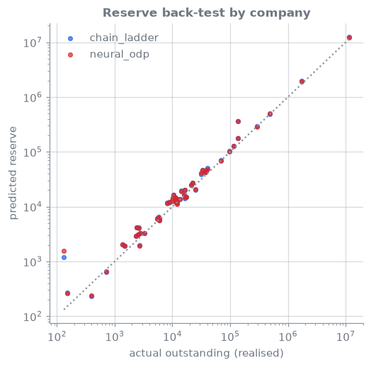
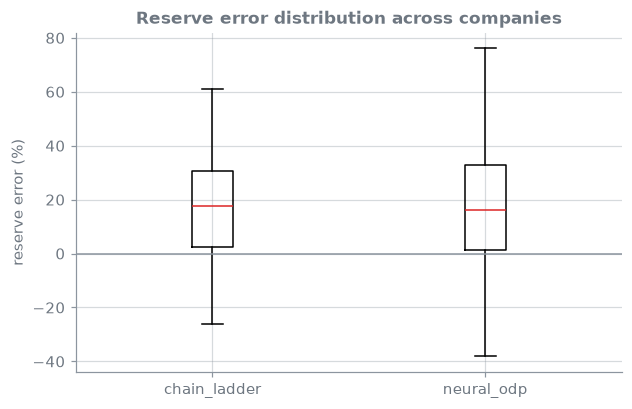

<!-- _class: lead -->
# 06 · Reserving: chain-ladder to neural ODP
### A CANN for triangles, back-tested on what was actually paid

[](https://colab.research.google.com/github/actuarialsociety/deep-actuarial-science/blob/main/notebooks/06_reserving.ipynb) [](https://kaggle.com/kernels/welcome?src=https://github.com/actuarialsociety/deep-actuarial-science/blob/main/notebooks/06_reserving.ipynb) [](https://console.aws.amazon.com/sagemaker/home#/studio-landing) · `kedro run --pipeline reserving`

**Reproduces:** Kuo (2019) [[4](https://doi.org/10.3390/risks7030097)], Table 1, Mack / chain-ladder on Meyers' (2015) [[3](https://www.casact.org/sites/default/files/2021-03/7_Meyers_2015.PDF)] private passenger auto companies

---

<!-- _class: theory -->

## Theory

**Model 1: over-dispersed Poisson (ODP) model**, which reproduces the chain-ladder [[1](https://doi.org/10.1017/S1357321700000222)]

```math
\mathbb{E}[X_{i,j}] = \mu_{i,j} = \exp(\alpha_i + \beta_j), \quad
\mathrm{Var}(X_{i,j}) = \varphi\thinspace\mu_{i,j}
```

where $X_{i,j}$ = claims paid for accident year $i$ in development year $j$; $\mu_{i,j}$ = their expected value; $\alpha_i$ = accident-year level; $\beta_j$ = development-year (payment pattern) effect; $\varphi$ = dispersion: variance as a multiple of the mean

**Model 2: neural ODP**, a CANN for triangles [[5](https://doi.org/10.1080/03461238.2019.1633394)]

```math
\log \mu^{(c)}_{i,j} = \log \mu^{\mathrm{CL},(c)}_{i,j} + \mathrm{NN}\big(e_c,\thinspace e_{\ell},\thinspace e_j,\thinspace i\big),
\qquad \mathrm{NN}\equiv 0 \text{ at initialisation}
```

where $c$ = company; $\ell$ = line of business; $\mu^{\mathrm{CL},(c)}_ {i,j}$ = company $c$'s chain-ladder (ODP) mean, used as offset; $e_c, e_\ell, e_j$ = learned 2-dimensional embeddings of company, line and development year; $\mathrm{NN}$ = a network with two tanh layers

---

## Core ideas

_Click a panel to open it; work through them in order._

<details>
<summary><b>① The triangle and the answer key</b></summary>

$X_{i,j}$ = paid for accident year $i$ (1988–1997) in development year $j = 1,\dots,10$; $C_{i,j} = \sum_{k\le j} X_{i,k}$ = cumulative paid, floored at 1 as in [[3](https://www.casact.org/sites/default/files/2021-03/7_Meyers_2015.PDF)]. Cells with $i + j - 1 \le 1997$ are known; the rest are future payments, whose sum is the **reserve**. The CAS data contain what was later paid, so every reserve is checked.

</details>

<details>
<summary><b>② Chain-ladder</b></summary>

**Chain-ladder**: $\hat f_j = \sum_i C_{i,j+1} / \sum_i C_{i,j}$, $\hat C_{i,j+1} = \hat C_{i,j}\thinspace\hat f_j$

where $\hat f_j$ = development factor from year $j$ to $j+1$, over accident years where both are known; $\hat C_{i,j}$ = projected cumulative from the latest known value. Its point estimate equals Mack's [[2](https://doi.org/10.2143/AST.23.2.2005092)] and the ODP model's [[1](https://doi.org/10.1017/S1357321700000222)].

</details>

<details>
<summary><b>③ Kuo's metrics, on Meyers' companies</b></summary>

**Percentage error of company $c$'s ultimate** [[4](https://doi.org/10.3390/risks7030097)]: $\mathrm{PE}_ c = \hat U_c / U_c - 1$

where $U_c$ = actual total paid at development year 10 over all accident years; $\hat U_c$ = predicted. Over Meyers' [[3](https://www.casact.org/sites/default/files/2021-03/7_Meyers_2015.PDF)] 50 companies: $\mathrm{MAPE} = \mathrm{mean}\thinspace|\mathrm{PE}_ c|$, $\mathrm{RMSPE} = (\mathrm{mean}\thinspace\mathrm{PE}_ c^2)^{1/2}$, unweighted.

</details>

<details>
<summary><b>④ Neural ODP: a CANN for triangles</b></summary>

As in [[5](https://doi.org/10.1080/03461238.2019.1633394)]: chain-ladder means as offset; embeddings of company, line and development year plus a scaled accident year; two tanh layers (16, 8); output initialised at zero, so training starts **at the chain-ladder**. Payments divided by each company's premium; Poisson loss; full-batch Adam. The number of epochs is chosen out of time: offsets and training use calendar years up to 1996 only, and the 1997 diagonal validates (offsets fitted to that diagonal would make any learning look worse). The network is then refitted on the whole triangle for that many epochs.

</details>

<details>
<summary><b>⑤ Reserve back-test</b></summary>

Per company, reserve error $= \hat R / R - 1$ with $\hat R$ the predicted and $R$ the realised reserve ($R > 0$). Reported: the total error over companies, the median absolute company error, and the share within ±10%. Reserve errors are larger than ultimate errors because paid-to-date is excluded.

</details>

---

## Results: reconciled to Kuo (2019) [[4](https://doi.org/10.3390/risks7030097)], Table 1

Private passenger auto, Meyers' [[3](https://www.casact.org/sites/default/files/2021-03/7_Meyers_2015.PDF)] <!--r:chain_ladder.n_companies-->50<!--/r--> companies, paid; errors of total ultimate loss.

| Model | Paper, table | Published MAPE / RMSPE | This repo MAPE | This repo RMSPE | Status |
| --- | --- | --- | --- | --- | --- |
| Chain-ladder | [[4](https://doi.org/10.3390/risks7030097)], Table 1, Mack | 0.038 / 0.061 | <!--r:chain_ladder.mape_ultimate-->0.03815<!--/r--> | <!--r:chain_ladder.rmspe_ultimate-->0.06057<!--/r--> | <!--r:chain_ladder.status-->PASS<!--/r--> |
| Neural ODP | none published | n/a | <!--r:neural_odp.mape_ultimate-->0.03871<!--/r--> | <!--r:neural_odp.rmspe_ultimate-->0.06596<!--/r--> | comparable only |
| DeepTriangle | [[4](https://doi.org/10.3390/risks7030097)], Table 1 | 0.025 / 0.039 | not implemented | | |

Also checked: the chain-ladder equals the `chainladder` package to <!--r:chain_ladder.package_diff-->2.0e-15<!--/r-->. DeepTriangle (a GRU on paid and incurred data) and Mack-Net [[6](https://doi.org/10.1016/j.eswa.2022.117146)] use the same companies but different models and data, so the neural ODP is compared, not reconciled.

---

## Reserve back-test

| Model | Total reserve error | Median abs. company error | Companies within ±10% |
| --- | --- | --- | --- |
| Chain-ladder | <!--r:chain_ladder.total_reserve_error_pct-->+10.8<!--/r-->% | <!--r:chain_ladder.median_abs_error_pct-->20.3<!--/r-->% | <!--r:chain_ladder.share_within_10pct-->26%<!--/r--> |
| Neural ODP | <!--r:neural_odp.total_reserve_error_pct-->+8.2<!--/r-->% | <!--r:neural_odp.median_abs_error_pct-->18.6<!--/r-->% | <!--r:neural_odp.share_within_10pct-->30%<!--/r--> |

Gap in MAPE, chain-ladder ahead, paired over the 50 companies (lesson 00, Core ideas ⑥): <!--r:gap.neural_odp.chain_ladder-->0.0006 (-0.0025 to 0.0036)<!--/r-->, <!--r:verdict.neural_odp.chain_ladder-->not distinguishable<!--/r--> but a hundredth of the MAPE itself. Best epoch <!--r:neural_odp.best_epoch-->224<!--/r-->, chosen on the 1997 diagonal. The correction trims the chain-ladder's over-reserving (total error above), but on each company's ultimate loss it cannot be told apart from the chain-ladder: with a per-company chain-ladder offset, little shared structure is left to learn.

 

---

## In production

- **Back-test before trusting:** hold out diagonals; compare to realised development
- **The chain-ladder anchor** keeps results explainable to a reserving committee
- **Uncertainty:** Mack [[2](https://doi.org/10.2143/AST.23.2.2005092)] or bootstrap for the chain-ladder; ensembles for the network
- **Give the network something to learn:** a pooled, line-level chain-ladder offset lets company deviations be learned; that is this lesson's exercise
- **Fully neural alternatives** (DeepTriangle [[4](https://doi.org/10.3390/risks7030097)], Mack-Net [[6](https://doi.org/10.1016/j.eswa.2022.117146)]) drop or reshape the anchor: benchmark both

---

## Learn more

1. Renshaw, A. E., & Verrall, R. J. (1998). A stochastic model underlying the chain-ladder technique. *British Actuarial Journal*, 4(4), 903–923. [doi:10.1017/S1357321700000222](https://doi.org/10.1017/S1357321700000222)
2. Mack, T. (1993). Distribution-free calculation of the standard error of chain ladder reserve estimates. *ASTIN Bulletin*, 23(2), 213–225. [doi:10.2143/AST.23.2.2005092](https://doi.org/10.2143/AST.23.2.2005092)
3. Meyers, G. (2015). *Stochastic Loss Reserving Using Bayesian MCMC Models*. CAS Monograph No. 1 (company list: Appendix A, Table 12). [PDF](https://www.casact.org/sites/default/files/2021-03/7_Meyers_2015.PDF)
4. Kuo, K. (2019). DeepTriangle: a deep learning approach to loss reserving. *Risks*, 7(3), 97. [doi:10.3390/risks7030097](https://doi.org/10.3390/risks7030097)
5. Gabrielli, A., Richman, R., & Wüthrich, M. V. (2020). Neural network embedding of the over-dispersed Poisson reserving model. *Scandinavian Actuarial Journal*, 2020(1), 1–29 (results on simulated data). [doi:10.1080/03461238.2019.1633394](https://doi.org/10.1080/03461238.2019.1633394)
6. Ramos-Pérez, E., Alonso-González, P. J., & Núñez-Velázquez, J. J. (2022). Mack-Net model: blending Mack's model with recurrent neural networks. *Expert Systems with Applications*, 201, 117146. [doi:10.1016/j.eswa.2022.117146](https://doi.org/10.1016/j.eswa.2022.117146)

Data: [CAS Loss Reserving Database](https://www.casact.org/publications-research/research/research-resources/loss-reserving-data-pulled-naic-schedule-p).

_Last reviewed: 2026-11-10_
