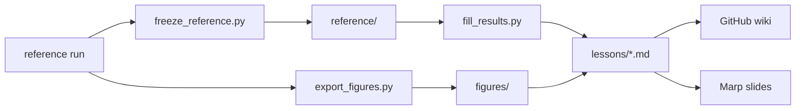

# `lessons/`

Marp slide decks, one per model family. The same Markdown renders on GitHub, on the wiki
(`scripts/build_wiki.py`) and as slides (`marp.config.mjs`). Numbers are filled from
`reference/` by `scripts/fill_results.py`; never type them.

| Deck | Models |
| --- | --- |
| `00 Quickstart.md` | the whole toolkit, how to read PASS/FAIL and gaps |
| `01 Baselines - GLM and GBM.md` | homogeneous, GLM1, GLM3, GBM |
| `02 Neural Networks - FNN and Embeddings.md` | FNN with embeddings |
| `03 CANN.md` | CANN on GLM3 |
| `04 LocalGLMnet.md` | LocalGLMnet |
| `05 Mortality - Lee-Carter to Deep Learning.md` | Lee-Carter, CNNs, LSTM, Transformer |
| `06 Reserving - Chain-Ladder to Neural ODP.md` | chain-ladder, neural ODP |
