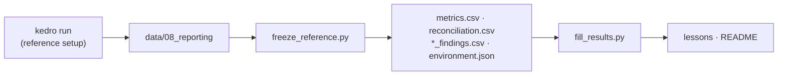

# `reference/`: the frozen reference run

The single source of every number in the lessons, the README and the notebooks' "reference
run" columns. Written by `scripts/freeze_reference.py` from a full run at the reference setup
(`conf/base`); never edit by hand. `pytest` fails if a lesson disagrees with it.

| File | Holds |
| --- | --- |
| `metrics.csv` | every metric of every model |
| `reconciliation.csv` | paper value, this repo's value, tolerance, PASS/FAIL, source |
| `frequency_findings.csv`, `mortality_findings.csv`, `reserving_findings.csv` | which gaps between models are real (Holm-adjusted); where a published run falls among our seeds |
| `environment.json` | date, commit, device and package versions of the freeze |
