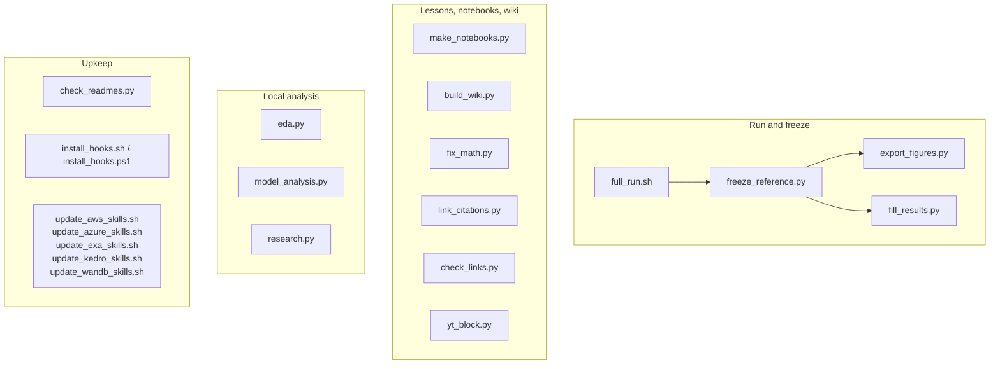

# `scripts/`

Every core task as a script. Python scripts run on any OS; shell scripts have PowerShell
twins where noted.

| Script | Does |
| --- | --- |
| `full_run.sh` | every pipeline at the reference setup, freeze, then scale-up; MPS, logged to W&B |
| `freeze_reference.py` | latest reference run → `reference/`, then figures and numbers |
| `export_figures.py` | copies the lesson figures from the run |
| `fill_results.py` | fills every number in the lessons and README from `reference/` (`--check` in CI) |
| `make_notebooks.py` | generates `notebooks/` |
| `build_wiki.py` | builds the wiki from README and lessons (run by `wiki-sync.yml`) |
| `fix_math.py` | GitHub-safe LaTeX (`--github` renders through GitHub's API) |
| `link_citations.py` | links each `[N]` to the paper (`--check` in CI) |
| `check_links.py` | checks every link in the Markdown |
| `yt_block.py` | YouTube IDs → lesson-ready Markdown |
| `eda.py` | local EDA reports per dataset (`data/10_eda/`) |
| `model_analysis.py` | local model-behaviour reports (`data/11_model_analysis/`) |
| `research.py` | local library of every cited paper, full-text search (`data/12_research/`) |
| `check_readmes.py` | every folder's README matches its code (pre-push hook and CI) |
| `install_hooks.sh`, `install_hooks.ps1` | enable the hooks in `.githooks/` (once per clone) |
| `update_aws_skills.sh`, `update_azure_skills.sh`, `update_exa_skills.sh`, `update_kedro_skills.sh`, `update_wandb_skills.sh` | re-vendor agent skills into `.claude/skills/` |
