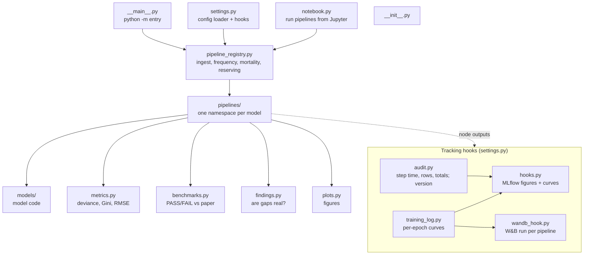

# `deep_actuarial_science` package

The Kedro project: pipelines that fit each model, score it and reconcile it to its paper, plus
the shared pieces they use. Run with `kedro run` (or `python -m deep_actuarial_science`).

| File | Role |
| --- | --- |
| `__init__.py` | package description; `__version__` read from `pyproject.toml` |
| `__main__.py` | `python -m deep_actuarial_science` behaves like `kedro run` |
| `settings.py` | OmegaConfigLoader (soft-merged parameters, env resolver) and the tracking hooks |
| `pipeline_registry.py` | registers `ingest`, `frequency`, `mortality`, `reserving` |
| `metrics.py` | scoring rules: Poisson deviance (per policy, ×10⁻²), balance, Gini, RMSE |
| `benchmarks.py` | `reconcile`: each metric against the paper's value and tolerance (`2sd`, `2se`) |
| `findings.py` | paired 95% intervals and Holm-adjusted verdicts for model gaps; published run vs our seeds |
| `plots.py` | every diagnostic figure (returns a matplotlib Figure) |
| `training_log.py` | turns every model's training history into one per-epoch table |
| `hooks.py` | MLflow: figures and per-epoch training curves; `AuditHook`: the audit trail and model version for MLflow and W&B |
| `audit.py` | per-step duration, row counts and reconciled totals (claims, exposure, premium, paid, reserves); `version()` = package version + git commit |
| `wandb_hook.py` | optional W&B logging (`WANDB_PROJECT`): config, metrics, tables, figures, curves |
| `notebook.py` | run and inspect pipelines from a notebook (local, container, Colab) |
