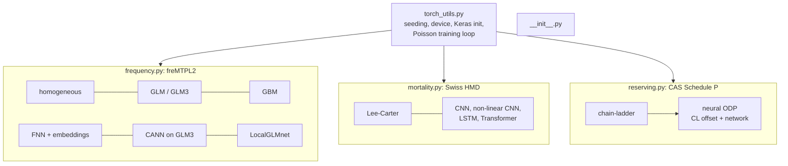

# `models/`

Model code, one module per domain, independent of Kedro: each fits on data frames and returns
predictions, so a notebook can call it directly.

| File | Role |
| --- | --- |
| `__init__.py` | package marker |
| `torch_utils.py` | `seed_everything`, `device` (MPS/CUDA/CPU), Keras initialisers, `train_poisson` with early stopping |
| `frequency.py` | homogeneous, GLM, GBM (LightGBM), FNN, CANN, LocalGLMnet; multi-seed networks average their runs |
| `mortality.py` | Lee-Carter (SVD + drift) and four networks on 10-year windows of log m, forecast recursively |
| `reserving.py` | chain-ladder and neural ODP; epochs chosen out of time on the 1997 diagonal |
