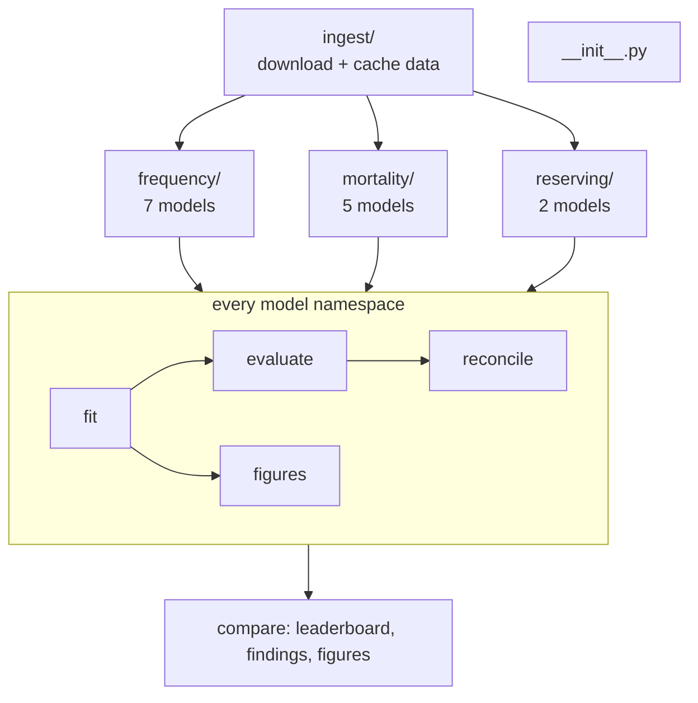

# `pipelines/`

One Kedro pipeline per domain. Each model is its own namespace (`kedro run --namespaces fnn`),
so the dataset factories in `conf/base/catalog.yml` cover every model without catalog edits.

| Folder | Pipeline |
| --- | --- |
| `__init__.py` | package marker |
| `ingest/` | AI Tools data (freMTPL2, Swiss HMD) and CAS Schedule P, cached in `data/01_raw` |
| `frequency/` | claim frequency on freMTPL2 |
| `mortality/` | Swiss mortality forecasting |
| `reserving/` | paid-loss reserving, back-tested on the realised lower triangle |
