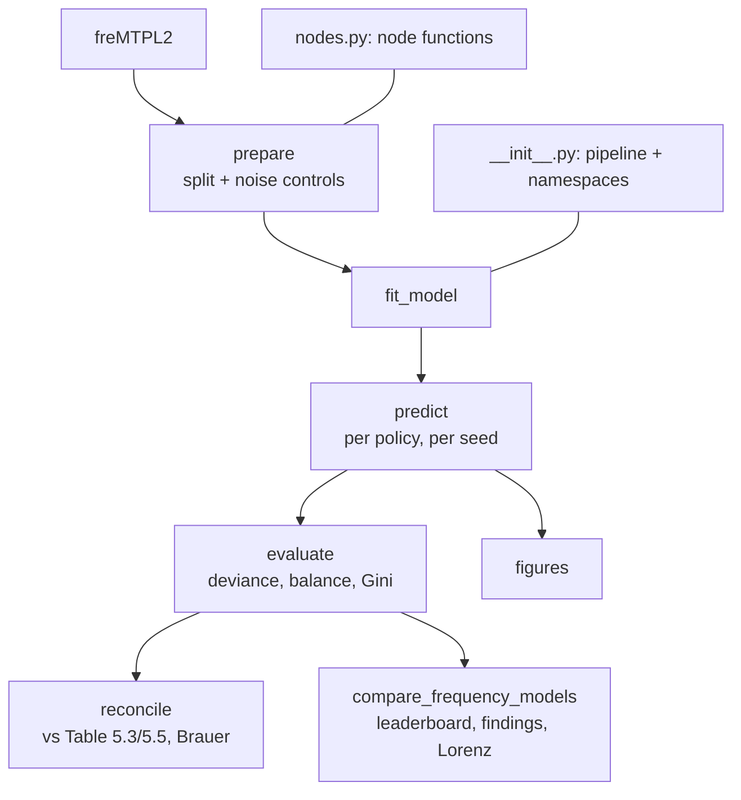

# `pipelines/frequency/`

Claim frequency on freMTPL2 with the fixed learn/test split of Wüthrich & Merz (2023).

| File | Role |
| --- | --- |
| `__init__.py` | builds the pipeline: one namespace per model in `MODELS`, then the comparison |
| `nodes.py` | `prepare`, `fit_model`, `predict`, `evaluate`, `figures`, `reconcile`, `make_compare` |
