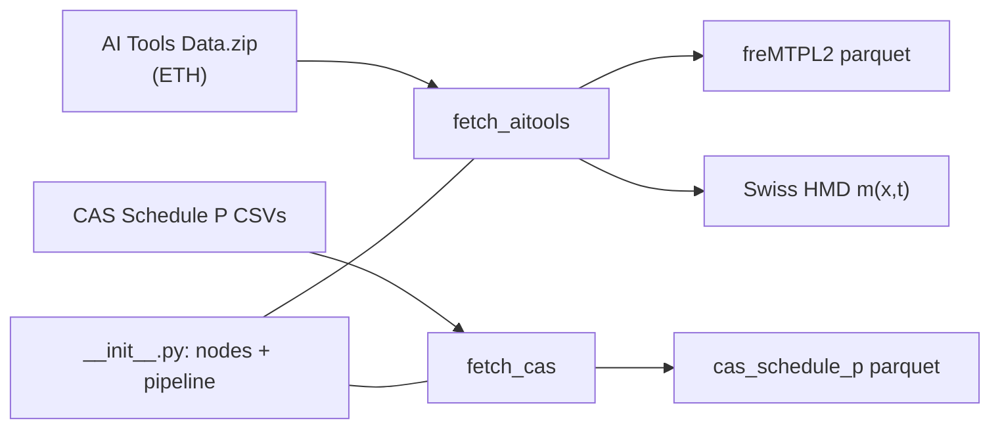

# `pipelines/ingest/`

Downloads the public data once and caches it in `data/01_raw`; the other pipelines reuse its
nodes (`aitools_node`, `cas_node`) so each runs on its own.

| File | Role |
| --- | --- |
| `__init__.py` | the download nodes and the `ingest` pipeline; sources in `conf/base/parameters.yml` |
