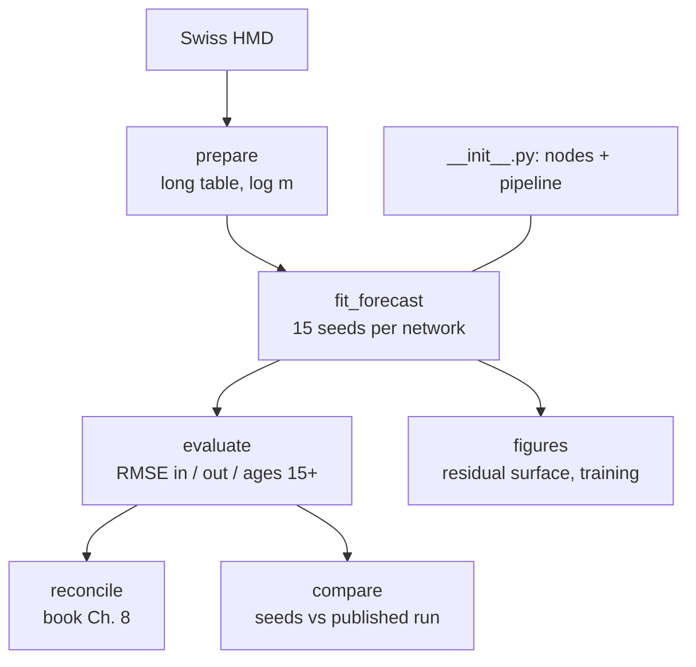

# `pipelines/mortality/`

Swiss mortality: learn 1900–1999, forecast 2000–2021, RMSE of log m(x,t) against
Richman, Scognamiglio & Wüthrich (2026), Ch. 8.

| File | Role |
| --- | --- |
| `__init__.py` | nodes (`fit_forecast`, `evaluate`, `figures`, `reconcile`, `compare`) and the pipeline |
