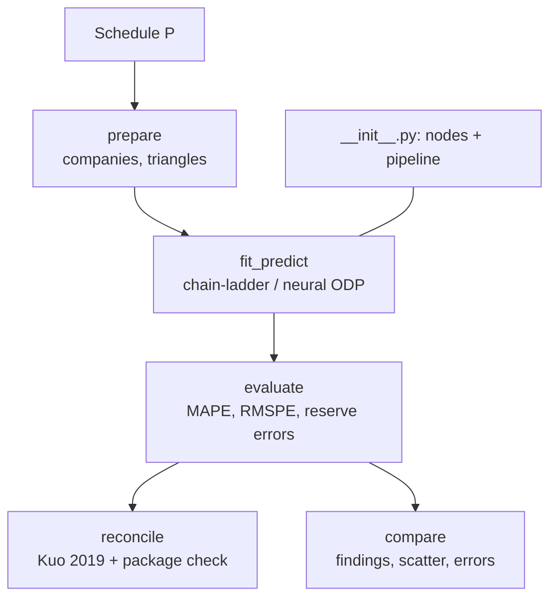

# `pipelines/reserving/`

Paid-loss reserving on CAS Schedule P, back-tested on what was actually paid, reconciled to
Kuo (2019), Table 1, and cross-checked against the `chainladder` package.

| File | Role |
| --- | --- |
| `__init__.py` | nodes (`fit_predict`, `evaluate`, `reconcile`, `compare`), the package cross-check and the pipeline |
