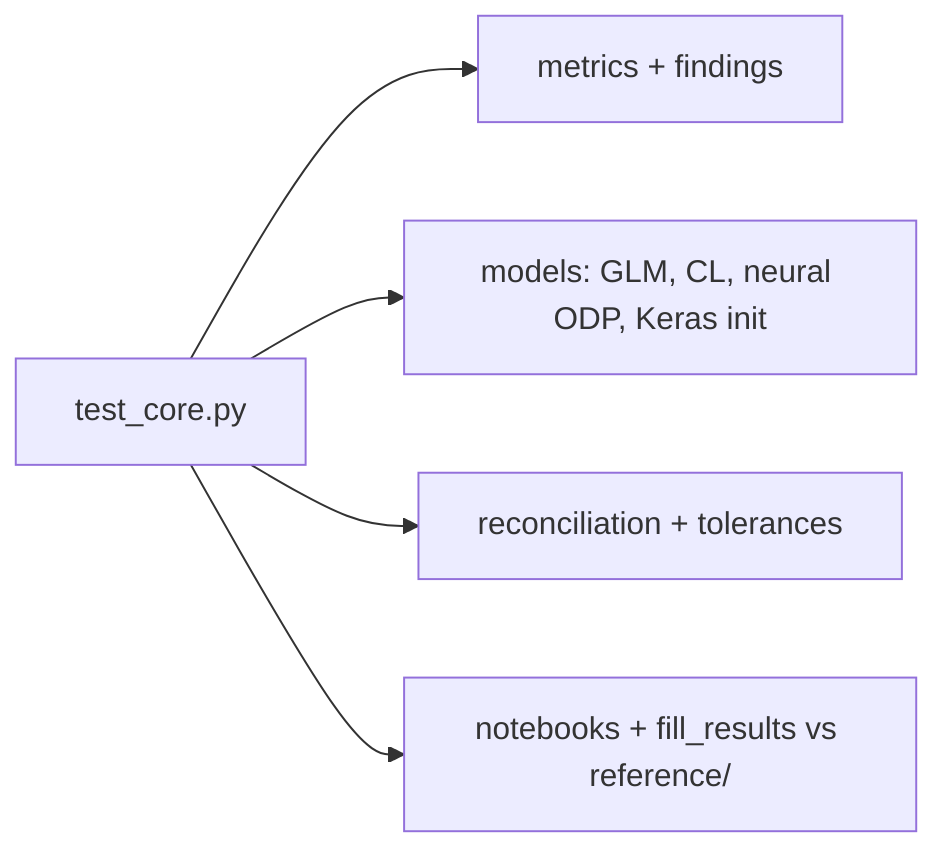

# `tests/`

`pytest -q`: fast checks of the scoring rules, models, reconciliation, findings, notebooks and
that the lessons and README agree with `reference/`. The smoke run (`kedro run --env smoke`)
covers the pipelines end to end.

| File | Covers |
| --- | --- |
| `test_core.py` | all unit and consistency tests |
